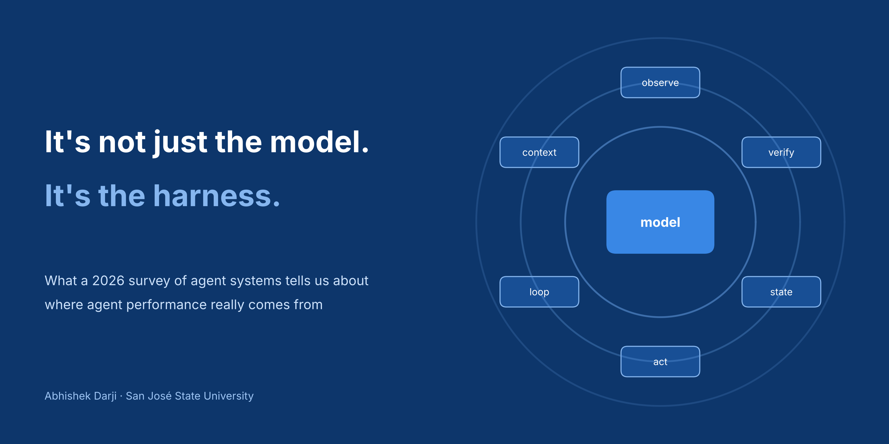
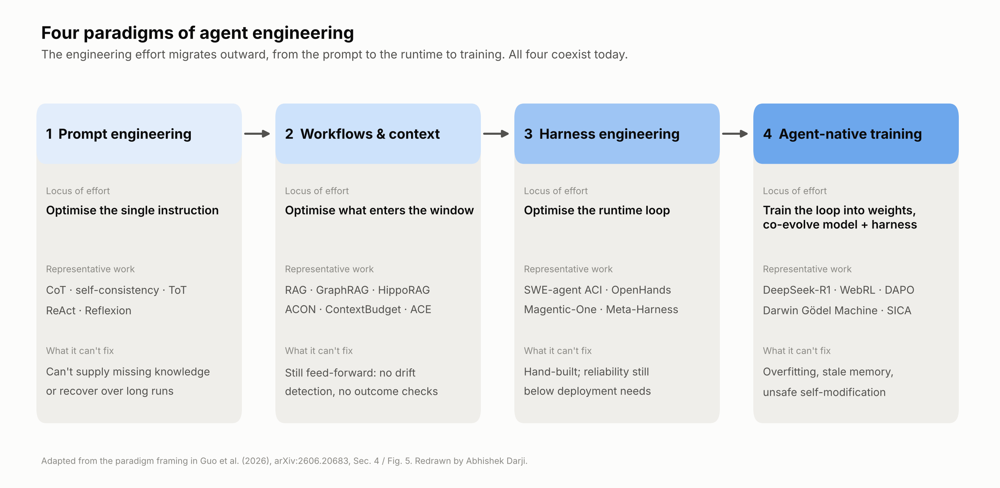
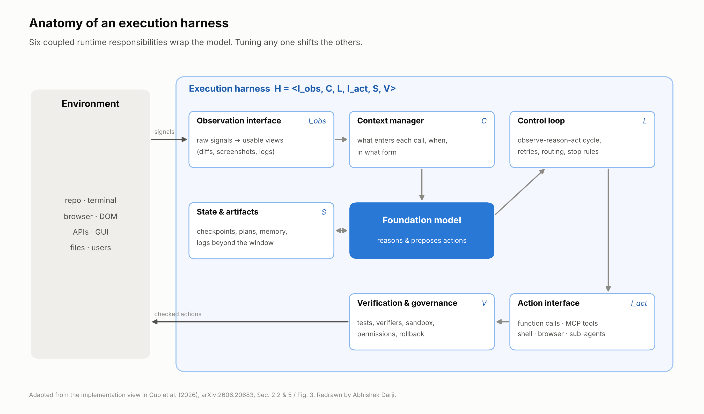
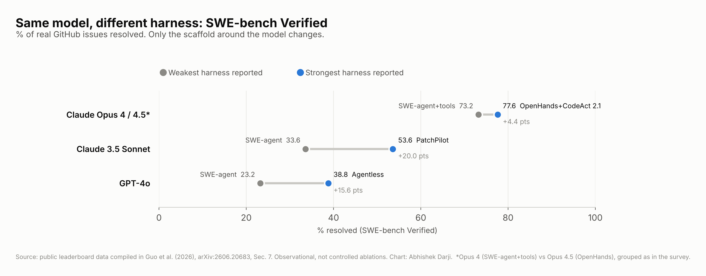
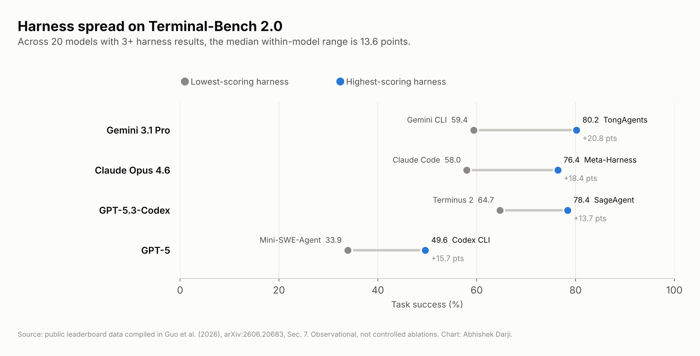
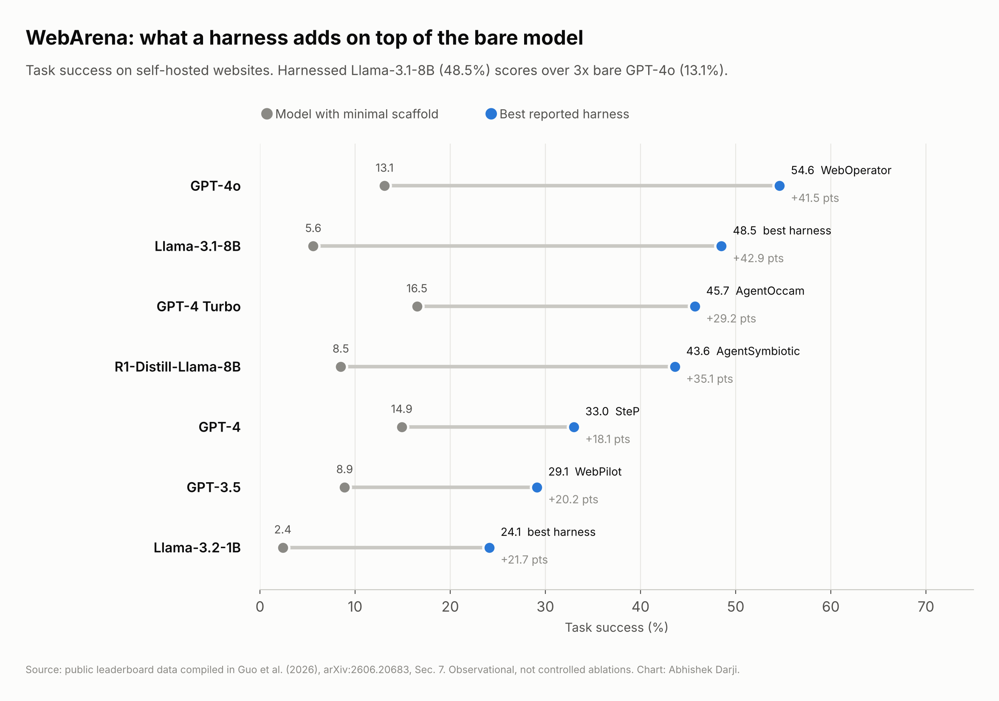
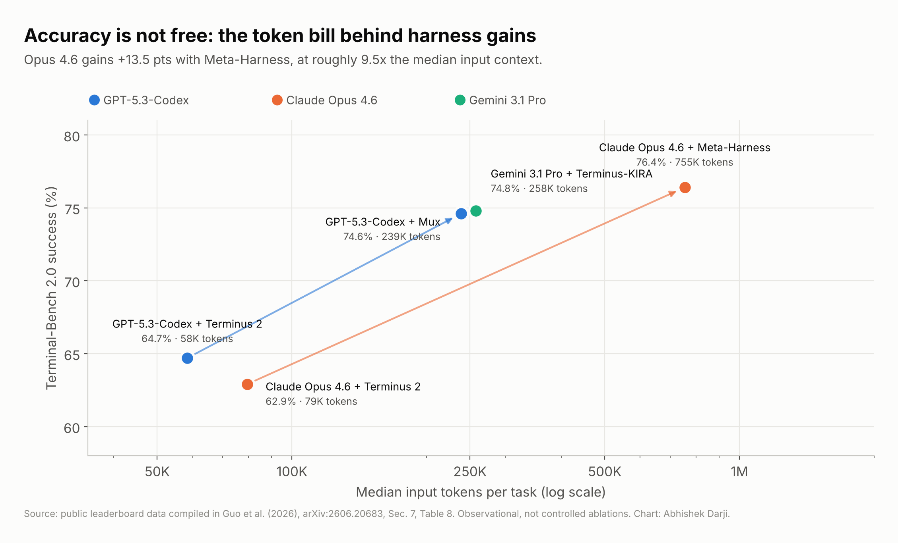

# It's Not Just the Model, It's the Harness

**Short story assignment (individual)** · Abhishek Darji · MS Software Engineering (Data Science), San José State University

A short story on **agent system and harness design**, built around a recent survey and four companion surveys. It covers the field's taxonomy, the harness techniques at the top of agent leaderboards, the empirical evidence, and my own view of the work.



---

## Deliverables

| Deliverable | Link |
|---|---|
| Medium article | `https://medium.com/@<your-handle>/...` *(add after publishing)* |
| SlideShare deck | `https://www.slideshare.net/...` *(add after uploading)* |
| YouTube presentation (15+ min) | `https://youtu.be/...` *(add after uploading)* |
| Slides (PowerPoint) | [`slides/Agent_Harness_Short_Story.pptx`](slides/Agent_Harness_Short_Story.pptx) |
| Slides (PDF) | [`slides/Agent_Harness_Short_Story.pdf`](slides/Agent_Harness_Short_Story.pdf) |
| Article source (Markdown + figures) | [`article/medium_article.md`](article/medium_article.md) |
| Video script with timings | [`video/video_script.md`](video/video_script.md) |
| Recorded video | [`video/`](video/) |

---

## The anchor survey

**From Question Answering to Task Completion: A Survey on Agent System and Harness Design**
Jianyuan Guo, Zhiwei Hao, Cheng Fan, … Chang Xu, Yunhe Wang
City University of Hong Kong · University of Sydney · Peking University · TokenRhythm Technologies
arXiv:2606.20683 (June 2026) · [paper](https://arxiv.org/abs/2606.20683) · [paper list](https://github.com/ggjy/Awesome-Agent-Engineering)

**Why I picked it:** it is recent, it is about how agents are *built and operated* (LLMOps and AI engineering) rather than only about what models know, and it analyzes real leaderboard data instead of just listing papers.

### Companion surveys

| Survey | Venue / date | What it adds |
|---|---|---|
| [Code as Agent Harness](https://arxiv.org/abs/2605.18747) (Ning et al., UIUC / Meta / Stanford) | arXiv, May 2026 | Code as the harness substrate: executable, inspectable, stateful |
| [Software Engineering for LLM-Based Agents: A Lifecycle-Oriented Survey](https://arxiv.org/abs/2611.23260) (Ge et al.) | arXiv, Oct 2026 | Agents engineered across five software-lifecycle stages |
| [Log Analysis for LLM-Based Agents: A Lifecycle-Oriented Survey](https://arxiv.org/abs/2611.23281) (Wang et al.) | arXiv, Oct 2026 | Agent traces as evidence for debugging and evaluation (90 studies) |
| A Survey on Evaluation of LLM-Based Agents (Yehudai et al.) | Findings of ACL 2026 | What to measure beyond task success |

---

## Summary

### 1. Taxonomy: four paradigms of agent engineering



| Paradigm | Locus of effort | Examples | Limitation |
|---|---|---|---|
| Prompt engineering | The single instruction | CoT, self-consistency, ToT, ReAct, Reflexion | Can't add missing knowledge or recover over long runs |
| Workflows and context engineering | What enters the context window | RAG, GraphRAG, HippoRAG, ACON, ContextBudget, ACE | Feed-forward: nothing checks the outcome |
| Harness engineering | The runtime loop | SWE-agent ACI, OpenHands, Magentic-One, Meta-Harness | Hand-built; reliability below deployment needs |
| Agent-native training and co-evolution | Model weights, plus the model and harness together | DeepSeek-R1, DAPO, WebRL, Darwin Gödel Machine, SICA | Overfitting, stale memory, unsafe self-modification |

### 2. Architecture: the harness as six coupled components

`H = ⟨I_obs, C, L, I_act, S, V⟩`: observation interface, context manager, control loop, action interface, state and artifact store, verification and governance.



### 3. Evidence from leaderboards (observational, not controlled ablations)

| Finding | Number |
|---|---|
| Same model, different harness (Terminal-Bench 2.0) | Median within-model range of **13.6 pts** across 20 models; Gemini 3.1 Pro **59.4% → 80.2%** |
| Same model, different harness (WebArena) | GPT-4o **13.1% → 54.6%** (WebOperator) |
| Same model, different harness (SWE-bench Verified) | GPT-4o **23.2% → 38.8%** (Agentless); Claude 3.5 Sonnet **33.6% → 53.6%** (PatchPilot) |
| A small harness can match a large one | mini-SWE-agent (~100 lines) **76.8%** vs OpenHands **77.6%** with Claude Opus 4.5 |
| Model upgrades still matter | SWE-agent + tools: Claude 3.5 Sonnet **49.0%** → Claude Opus 4 **73.2%** |
| Accuracy has a cost | Opus 4.6 + Meta-Harness: **+13.5 pts** at about **9.5×** the median input tokens |

| | |
|---|---|
|  |  |
|  |  |

### 4. Open challenges

Value-aware evaluation (cost per effective success, P95 latency) · learning to verify and recover · safe co-evolution · generalization vs. specialization of harnesses · measurement quality of benchmarks.

### 5. My two cents (short version)

- **Strength:** the six-component tuple is a practical debugging checklist for any agent.
- **Gap:** the evidence can't separate harness design from extra compute, because many large gains come with roughly 10× the tokens. Equal-budget comparisons are needed.
- **Gap:** safety and governance get far less empirical attention than success rates.
- **For builders:** fix the interface before buying a bigger model, log every trace, report accuracy together with cost, and use the strongest oracle you can get.

The full discussion is in the [article](article/medium_article.md).

---

## Repository structure

```
agent-harness-short-story/
├── README.md
├── article/
│   └── medium_article.md        # Medium article (written from scratch)
├── figures/                     # 9 original figures used in the article and slides
├── slides/
│   ├── Agent_Harness_Short_Story.pptx   # 20 slides, speaker notes included
│   └── Agent_Harness_Short_Story.pdf
├── video/
│   └── video_script.md          # timed narration (~16.5 min)
├── papers/
│   └── README.md                # survey reading list with links
└── src/
    ├── make_figures.py          # regenerates all figures (matplotlib)
    ├── build_deck.js            # regenerates the deck (pptxgenjs)
    └── notes.json               # speaker notes / script source
```

### Reproduce the figures and slides

```bash
pip install matplotlib
python src/make_figures.py figures
npm install pptxgenjs sharp react react-dom react-icons
node src/build_deck.js
```

---

*All figures are my own diagrams and charts, made from numbers reported in the cited papers. The article and slides are original writing. No text was copied from existing Medium posts.*
