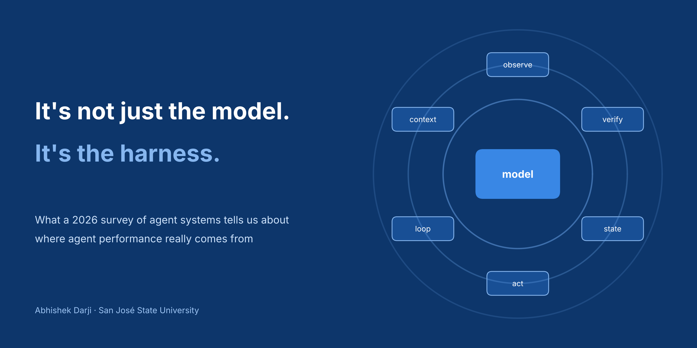
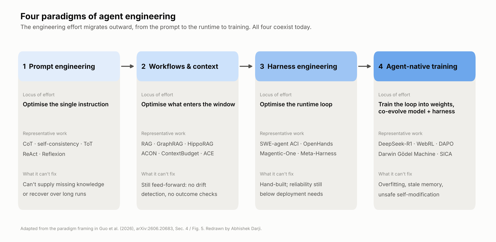
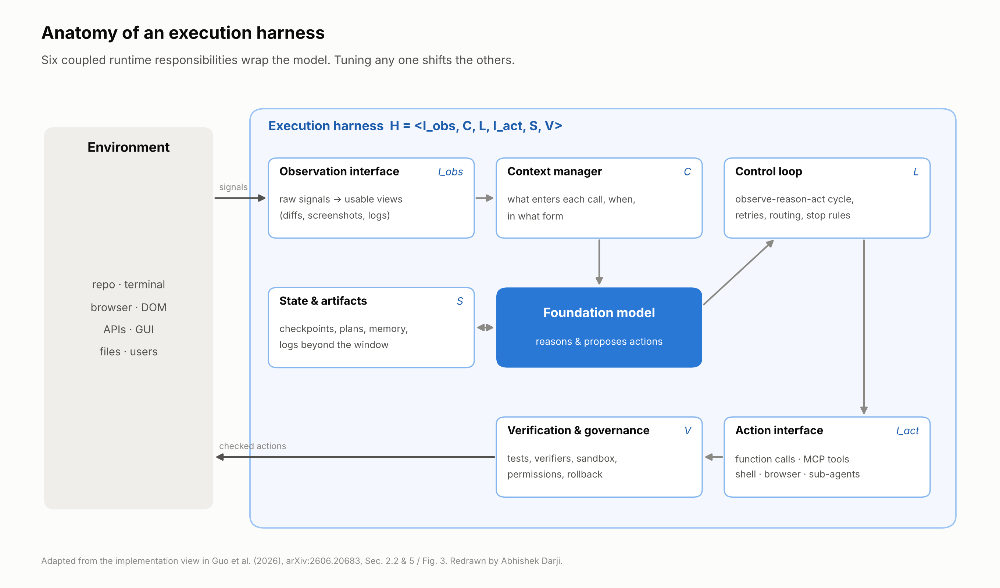
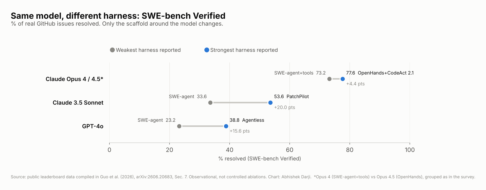
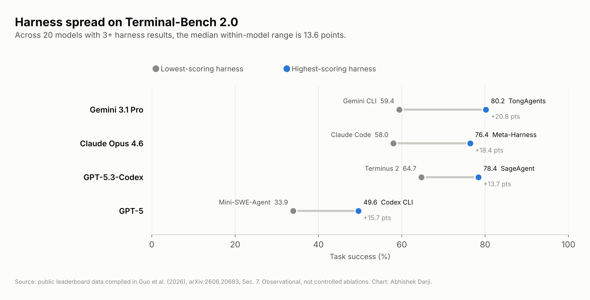
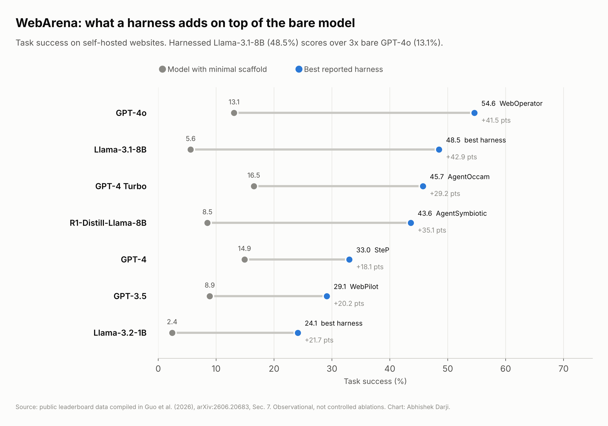
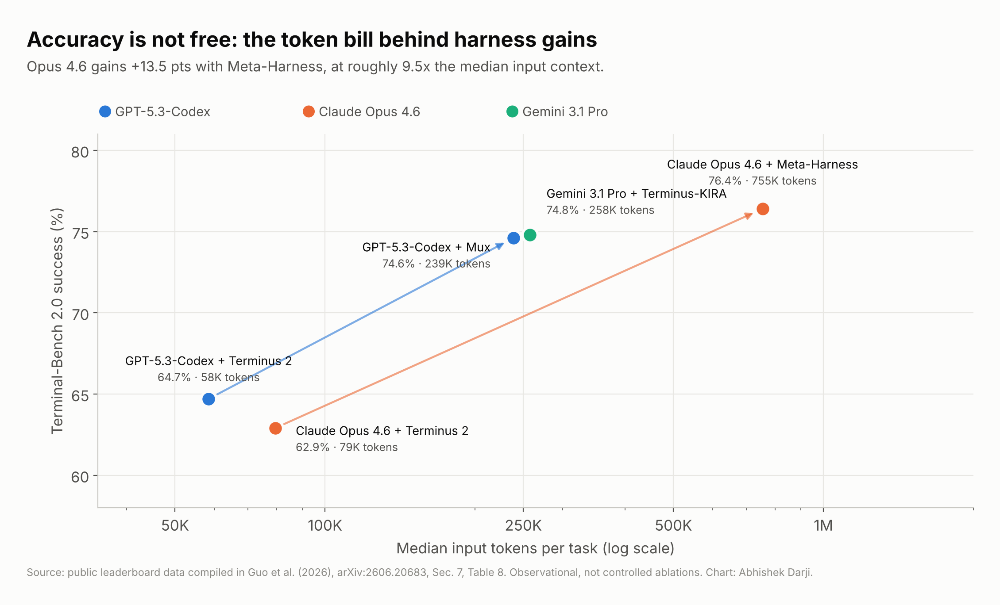
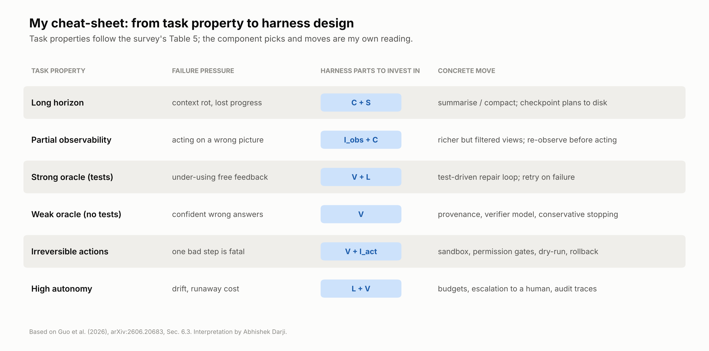
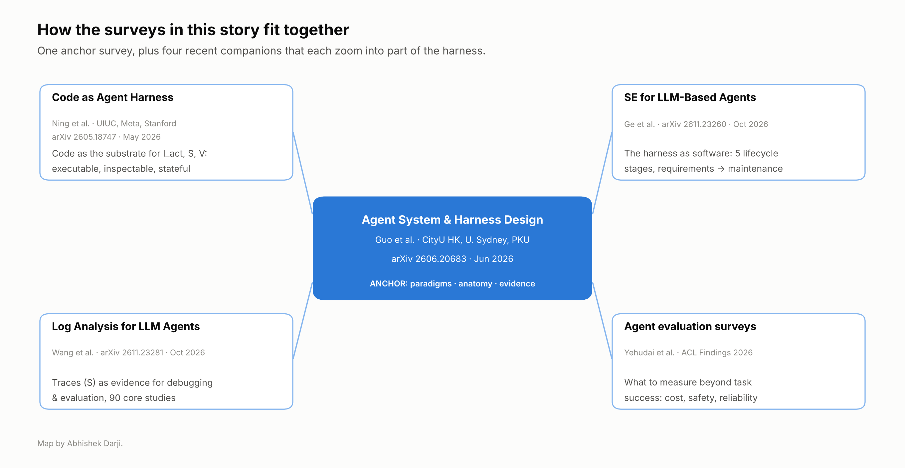

# It's Not Just the Model, It's the Harness

### What a 2026 survey of agent systems says about where agent performance really comes from

*By Abhishek Darji · MS Software Engineering (Data Science), San José State University*

---

Here is a number that changed how I think about AI agents. On **Terminal-Bench 2.0**, a benchmark where an agent has to finish real tasks inside a command line, **Gemini 3.1 Pro scores 59.4%** in one agent framework and **80.2%** in another. It's the same model with the same weights on the same tasks. The only thing that changed is the software wrapped around it, and that change is worth more than 20 points.

That gap is the subject of **"From Question Answering to Task Completion: A Survey on Agent System and Harness Design"** by Jianyuan Guo, Chang Xu, Yunhe Wang and colleagues from City University of Hong Kong, the University of Sydney, Peking University and TokenRhythm Technologies ([arXiv:2606.20683](https://arxiv.org/abs/2606.20683), June 2026). The authors name that wrapper the **execution harness**, and their main claim is easy to state: what an agent achieves now depends on the *pair* (model plus harness), not on the model alone.

In this short story I'll walk through the survey's taxonomy, the harness techniques it puts at the top of the leaderboards, and the evidence behind them. I'll also bring in four other recent surveys that each zoom in on one part of the harness, and I'll finish with my own view on where I think the paper is right and where it leaves gaps.

---

## 1. From answering questions to finishing tasks

For most of the chatbot era, we judged a language model by its answer to one question. Agents are judged differently. An agent gets a *goal* ("fix this failing test", "book the cheapest flight", "clean this dataset") and has to take many steps in a real environment to reach it. It reads files, runs commands, clicks buttons, reads the results, and tries again.

The survey's first contribution is to name the two halves of such a system clearly:

- The **foundation model** is the "cognitive engine". It reads an observation and proposes what to do next.
- The **harness** is everything else at runtime. It decides what the model sees, which tools it can call, what gets remembered, how the loop runs, and what gets checked before an action touches the world.

The authors back this up with a measurement argument. On static knowledge tests like MMLU-Pro and GPQA Diamond, frontier models from OpenAI, Anthropic and Google now sit in a narrow band near the top. Those tests no longer tell the best systems apart very well. On multi-step agent benchmarks, by contrast, results still spread out widely, and much of that spread comes from the harness.

---

## 2. The taxonomy: four paradigms of agent engineering

The survey organizes the field as a *migration of engineering effort*. These are not strict eras. All four exist side by side today, but the place where engineers spend their time keeps moving outward.

**Paradigm 1: Prompt engineering.** Here the work goes into how you phrase a single request. Chain-of-thought, self-consistency, tree-of-thought, ReAct and Reflexion all live here. The survey's critique is fair: a better prompt changes *how* you ask, but it cannot give the model knowledge it lacks, keep track of a changing world, or help it recover after it goes wrong 30 steps into a task.

**Paradigm 2: Workflows and context engineering.** The focus moves to what enters the context window, when, and in what shape. The survey sees three threads here. The first is **external knowledge**, through RAG, RETRO, Atlas, RAPTOR, GraphRAG and HippoRAG. The second is **active context management**, with methods like ACON (compression treated as an optimization problem), ContextBudget, and CAT (context upkeep as a callable tool). The third treats **context as something to evaluate**, with benchmarks like ContextBench and LoCoBench-Agent and adaptive methods like ACE. The main limit is that the flow is still feed-forward. Nothing notices drift, and nothing checks whether the outcome is actually right.

**Paradigm 3: Harness engineering.** Now the runtime itself becomes the thing you design. The model acts, sees the result, and reasons about it in a closed loop with sandboxing, checkpoints, verification and recovery. The survey picks out three sub-trends:

- **Interface design.** SWE-agent showed that improving the *agent-computer interface* raises scores even when the model stays fixed.
- **Multi-model harnesses.** Systems like Magentic-One and OpenHands route subtasks such as planning, coding and verification to different models.
- **Learnable harnesses.** Here the harness itself gets optimized. NLAH treats harness logic as editable text, Meta-Harness searches over harness configurations, and AHE evolves harness parts from execution traces.

**Paradigm 4: Agent-native training and co-evolution.** The newest stage tries to *train* planning, tool use and self-checking directly into the model's weights. It does this through reinforcement learning in interactive environments (DeepSeek-R1, DAPO, WebRL, ComputerRL, Kimi-Dev). A more radical branch lets the model *and* the harness improve together from their own traces (the Darwin Gödel Machine, SICA, AgentEvolver).

I found one distinction in this section especially clarifying. People use "self-evolving agent" loosely, and the survey splits it into three separate questions:

1. **Who** performs each role? (multi-model harnesses)
2. **How** is the policy optimized? (learnable harnesses)
3. **When and how** does everything update? (co-evolution)

---

## 3. The architecture: six parts of a harness

The core of the paper is a formal breakdown of the harness into six coupled runtime responsibilities, written as **H = ⟨I_obs, C, L, I_act, S, V⟩**.

| Component | What it does | Main trade-off | Representative work |
|---|---|---|---|
| **I_obs**: Observation interface | Turns raw signals (terminal output, diffs, screenshots, DOM trees, logs) into views the model can use | Richer views ground the model better but cost tokens and add distractors | SWE-agent's interface, WebArena, OSWorld |
| **C**: Context manager | Chooses what goes into each model call: retrieval, memory selection, summaries, compression | Fidelity vs. manageability | RAG, MemGPT |
| **L**: Control loop | Runs the observe-reason-act cycle: scheduling, retries, reflection, hand-offs, stopping rules, routing between models | Adaptability vs. stability | ReAct loops, planner-executor-verifier, Meta-Harness |
| **I_act**: Action interface | Turns model output into real operations: function calls, MCP tools, shell, browser, sub-agents | Flexibility vs. controllability | Function calling, MCP, ToolTok |
| **S**: State and artifact store | Keeps progress outside the context window: plans, checkpoints, memory, logs, files | Completeness vs. usability, plus stale state | Checkpoint stores, MemGPT, LoCoMo |
| **V**: Verification and governance | Checks and constrains execution: tests, linters, verifier models, sandboxes, permissions, budgets, rollback | Autonomy vs. robustness | Test-driven repair loops, act-or-refuse training |

The authors stress that these six are **coupled, not independent**. A bigger observation means more pressure on the context manager. A stronger verifier allows a more aggressive control loop. A good state store means the context can stay lean. In my view this is the most useful idea in the paper for anyone building agents. When an agent fails, the question becomes *which of the six broke*, rather than the vague question of whether the model is smart enough.

---

## 4. The evidence: what the leaderboards say

Section 7 is where the paper earns its claims. The authors gathered public leaderboard data across three benchmarks:

- **SWE-bench Verified**, which asks the agent to fix real GitHub issues
- **Terminal-Bench 2.0**, which asks the agent to finish command-line tasks checked by test scripts
- **WebArena**, which asks the agent to complete tasks on self-hosted shopping, forum, GitLab-style and map websites

They are careful to say these are *observational comparisons, not controlled ablations*. Even so, the patterns are consistent.

### Finding 1: the same model can swing widely across harnesses

On SWE-bench Verified, **GPT-4o resolves 23.2%** of issues inside SWE-agent and **38.8% inside Agentless**. **Claude 3.5 Sonnet goes from 33.6% to 53.6%** when it moves from SWE-agent to PatchPilot. Agentless is worth a closer look because it is *not* an open-ended agent loop at all. It is a fixed pipeline (localize, repair, validate), and on a task where tests give a mechanical yes or no, that structure beats a free-form loop. The survey draws a general lesson from this: **structured pipelines can beat agentic loops when success is mechanically checkable.**

Terminal-Bench 2.0 is the cleanest case. The authors processed 75 public submissions with logs, which comes to more than 32,000 trial records. Among 20 models that have at least three harness results, **the median gap between a model's best and worst harness is 13.6 points**, and 14 of the 20 vary by 10 points or more. Claude Opus 4.6 ranges from 58.0% (Claude Code) to 76.4% (Meta-Harness), and GPT-5.3-Codex from 64.7% (Terminus 2) to 78.4% (SageAgent).

WebArena shows the most dramatic version. **GPT-4o alone reaches 13.1%, but inside the WebOperator harness it reaches 54.6%**, a gain of 41.5 points. Small models gain a lot too. Llama-3.1-8B goes from 5.6% to 48.5% with a good harness, which beats bare GPT-4o by more than three times. When the authors compare models *inside one fixed harness* (BrowserGym), the ranking looks different again, so the claim that one model is better than another only holds for a given harness.

### Finding 2: a bigger harness is not automatically a better one

My favourite detail in the paper is **mini-SWE-agent**. It is roughly 100 lines of Python, and with Claude Opus 4.5 it reaches **76.8%** on SWE-bench Verified. That is only 0.8 points behind the much larger OpenHands framework (77.6%). The authors read this as evidence that **interface design matters more than feature count.** A clean way to see the repo and run commands can match a framework with many more features.

### Finding 3: model upgrades still matter a lot

Harnesses do not replace good models. Keep the harness fixed and upgrade the model, and the gains are large. In SWE-agent with tools, moving from Claude 3.5 Sonnet to Claude Opus 4 raises the score from 49.0% to 73.2%. In the Codex CLI harness on Terminal-Bench, GPT-5 scores 49.6% and GPT-5.5 scores 82.2%. The correct conclusion is that **model and harness both count, and they interact**, not that the harness is all that matters.

### Finding 4: higher accuracy usually costs more tokens

This is the result I think most leaderboard readers miss. With Claude Opus 4.6, Meta-Harness scores 76.4% against Terminus 2's 62.9%. It also uses a **median of about 755K input tokens per task, compared with about 79K**, nearly ten times as much. GPT-5.3-Codex under Mux shows the same pattern: +9.9 points for about four times the context. The authors are honest that cost data is thin (only about 15% of trials report dollar cost), so they avoid ranking harnesses by cost. The direction is still clear. Many harness gains are partly bought with extra compute.

### Finding 5: vendor scores sit a few points above open harnesses

Model vendors' own reported scores tend to be 2 to 4 points higher than the best open-source harness running the same model. For example, Opus 4.5 scores 80.9% as reported by the vendor and 77.6% in OpenHands. The survey attributes this to private scaffolding choices such as prompt design, picking among candidate answers, and spending more compute. My reading is that published model scores already include some harness engineering inside them.

---

## 5. Matching the harness to the task

The survey also links *task properties* to *harness design*. It ranks tasks by complexity, from L1 (single step) to L4 (open-ended), and lists the pressures that break agents: long horizons, partial observability, strong vs. weak oracles, irreversible actions and high autonomy. I turned that section into a cheat-sheet for my own use. The rows follow the paper, and the specific moves are my interpretation.

The principle I took away is this: **build the verifier around the oracle you actually have.** If you have tests, make the loop retry against them until they pass. If you don't, focus on provenance, conservative stopping, and asking a human.

---

## 6. Four companion surveys that zoom in

The harness survey is broad, and four other recent surveys each go deeper on one part of it.

**Code as Agent Harness** (Ning et al., UIUC, Meta and Stanford, [arXiv:2605.18747](https://arxiv.org/abs/2605.18747), May 2026) argues that *code* is becoming the material harnesses are made of. It is **executable**, so outcomes can be checked; **inspectable**, so failures can be traced; and **stateful**, so progress persists between steps. Its taxonomy has three layers: the harness interface (code for reasoning, acting and modelling the environment), harness mechanisms (planning, memory, tool use, plan-execute-verify), and scaling to many agents that share code artifacts. The idea I liked most is **agent-initiated artifacts**, meaning regression tests, temporary tools and reusable skills that the agent writes for itself. The authors say this area is still under-studied.

**Software Engineering for LLM-Based Agents: A Lifecycle-Oriented Survey** (Ge et al., [arXiv:2611.23260](https://arxiv.org/abs/2611.23260), October 2026) takes the view that an agent is a piece of software. It follows agent engineering through five stages: requirements, architecture and design, implementation and integration, testing and assurance, and maintenance and evolution. This is the right frame for **LLMOps**. A harness has to be versioned, tested and maintained like any other production system.

**Log Analysis for LLM-Based Agents** (Wang et al., [arXiv:2611.23281](https://arxiv.org/abs/2611.23281), October 2026) reviews 90 core studies on agent traces as evidence. It shows that logs are how we debug failures, evaluate agents beyond their final answer, and audit what an agent did. In harness terms, this survey covers the **S** and **V** components.

**A Survey on Evaluation of LLM-based Agents** (Yehudai et al., ACL Findings 2026) gives the broader map of agent benchmarks: capability tests, application-specific suites and generalist suites. It also explains why a single success rate tells only part of the story.

---

## 7. Open challenges

The survey ends with five open problems. I've written them in my own words:

1. **Value-aware evaluation.** Leaderboards report success and little else. The authors want *cost per effective success* and *P95 latency* reported alongside accuracy, along with safety and trace quality.
2. **Learning to verify and recover.** Self-checking today mostly comes from prompting. It should be trained, and any self-update should be kept only if it passes held-out tasks, regression tests and safety checks.
3. **Safe co-evolution.** When models and harnesses improve together, they risk overfitting to benchmarks, blaming the wrong component for failures, building up stale memory, and modifying themselves unsafely. Human approval and rollback are suggested for high-impact changes.
4. **Generalization vs. specialization.** Harnesses need a shared base (logging, permissions, cost accounting) with domain-specific adapters on top. Protocols like MCP and A2A help with connecting systems, but they do not solve this on their own.
5. **Measurement quality.** Benchmark checkers can be brittle and environments can leak, so audited variants such as WebArena Verified should be used for strong claims.

The authors also say plainly that **reported benchmark scores depend on runtime configuration**. They recommend that every reported result state the model version, harness, tool permissions, retry and timeout policy, environment, and token usage.

---

## 8. My two cents

**Where the paper is strongest.** The six-component formalism is the best mental model of an agent runtime I have read. It turns "the agent is flaky" into a debugging checklist. I also respect that the authors call their evidence observational in several places instead of overselling it.

**Where I'd push back.**

- *The evidence can't fully separate harness from compute.* Many of the biggest harness gains come with far more tokens, longer runs or more retries. Without controlled runs at equal budget, it's hard to say how much of a gain is better design and how much is simply more compute. I'd like to see a follow-up that fixes the budget and varies only the harness.
- *Safety gets less space than capability.* Verification and governance (V) is listed as a component, but the empirical section is almost all about success rates. Other recent surveys on the security of MCP tool calling (Karanjai et al., arXiv:2608.17275) and of long-term agent memory (Lin et al., arXiv:2604.16548) suggest that the attack surface grows as harnesses gain write-capable tools and persistent state.
- *Paradigm 4 is exciting but early.* Co-evolving models and harnesses is the most interesting direction, and also the hardest to evaluate honestly, because the system can overfit to the very benchmark used to measure it.

**What it means if you build agents.** I work on RAG and multi-agent systems, and this paper changed my checklist:

1. Before swapping in a bigger model, **try a cleaner interface**. The mini-SWE-agent result says simple and well-designed often wins.
2. **Log everything.** Without traces you can't tell which of the six components failed.
3. **Report accuracy together with cost.** A +13-point gain at ten times the tokens may not be worth it for a production budget.
4. **Use the strongest oracle you can get.** If you can turn a task into something testable, do it, and let the loop retry against the tests.

The headline I'm taking away is that a modern agent's score is really a score for *the model in its harness*. As frontier models start to look alike on static benchmarks, I expect more of the competition to move to harness design.

---

## References

1. Guo, J., Hao, Z., Fan, C., … Xu, C., Wang, Y. (2026). *From Question Answering to Task Completion: A Survey on Agent System and Harness Design.* arXiv:2606.20683. Paper list: github.com/ggjy/Awesome-Agent-Engineering
2. Ning, X., Tieu, K., Fu, D., et al. (2026). *Code as Agent Harness: Toward Executable, Verifiable, and Stateful Agent Systems.* arXiv:2605.18747.
3. Ge, Y., Feng, Y., Sun, W., et al. (2026). *Software Engineering for LLM-Based Agents: A Lifecycle-Oriented Survey.* arXiv:2611.23260.
4. Wang, C., Sun, Y., Xin, G., et al. (2026). *Log Analysis for LLM-Based Agents: A Lifecycle-Oriented Survey.* arXiv:2611.23281.
5. Yehudai, A., Eden, L., Li, A., et al. (2026). *A Survey on Evaluation of LLM-Based Agents.* Findings of ACL 2026.

*All figures are original diagrams and charts I made from data reported in the papers above.*
